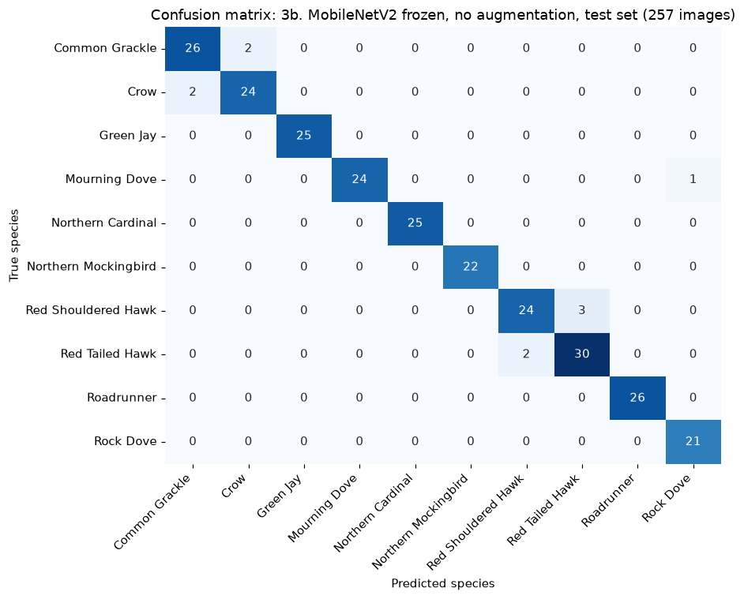

# Which Texas Bird Is It? Classifying 10 Species with CNNs

**DATA 4380 – Data Problems · Computer Vision Project · Fall 2026**
**Team:** Alejandro Alfonso · Tej Govindu · Mateen Jan
**Instructor:** Dr. Masoud Rostami
**Presentation:** Wednesday, November 18, 2026

---

## 1. The question

> **Can a convolutional neural network (CNN) identify 10 common Texas bird species from a single photo, and does it struggle most with birds that look alike?**

- **Task:** multi-class image classification (10 classes)
- **Input:** one 224 × 224 color photo of a bird
- **Target:** the bird's species

### Objectives
1. Build a **baseline** CNN and measure how well it does before any improvements.
2. Improve it step by step (data augmentation → transfer learning → fine-tuning → tuning), measuring the effect of **each** change on the validation set.
3. Evaluate the final model **once** on a held-out test set using accuracy, per-class precision/recall/F1 and a confusion matrix.
4. Check whether mistakes fall inside the **three lookalike pairs**, and whether the model looks at the bird or at the background.

**Why it matters:** bird-ID apps (e.g., Cornell's Merlin, iNaturalist) help birders, students and citizen-science projects record which species live where. Automatic identification from photos and camera traps speeds up wildlife monitoring.

---

## 2. The data

| | |
|---|---|
| **Source** | *BIRDS 525 Species – Image Classification* by Gerald Piosenka (originally on Kaggle). The Kaggle page has been removed; we use the identical files from the public mirror [`chriamue/bird-species-dataset`](https://huggingface.co/datasets/chriamue/bird-species-dataset) on Hugging Face. |
| **License** | CC0 1.0 (public domain) |
| **Full dataset** | 525 species, ~89,900 images |
| **Our subset** | **10 Texas species, 1,710 images**, all 224 × 224 RGB JPGs, one cropped bird per image |
| **Quality checks** | 0 broken files · 0 exact duplicates · all images the same size and color mode |
| **Class balance** | 142 – 212 images per species (largest ÷ smallest = 1.49, fairly balanced) |

### Our 10 species

| Distinctive birds | Lookalike pairs (expected to be hard) |
|---|---|
| Northern Cardinal | **Doves:** Mourning Dove vs. Rock Dove (pigeon) |
| Northern Mockingbird (Texas state bird) | **Hawks:** Red-tailed Hawk vs. Red-shouldered Hawk |
| Roadrunner | **Black birds:** Crow vs. Common Grackle |
| Green Jay | |

*The dataset has no Blue Jay, so we used the Green Jay, a jay found in South Texas.*

### Our split
The original dataset gives only **5 test images per species**, which is too few to measure anything reliably. We pooled all 1,710 images and made our own **stratified 70 / 15 / 15 split** (random seed 42):

| Train | Validation | Test |
|---|---|---|
| 1,197 | 256 | 257 |

- **Train:** the model learns from these.
- **Validation:** used to compare models and choose settings.
- **Test:** used **once**, at the very end, to report final results.

The split is saved in [`data/processed/splits.csv`](data/processed/splits.csv) so everyone gets the same one.

---

## 3. Workflow

```
Raw images → Data understanding → Minimum preprocessing → Train/val/test split
   → Baseline → Augmentation → Transfer learning → Fine-tuning → Tuning (validation only)
   → Final evaluation on test → Interpretation → Findings & conclusion
```

| Step | Model | What changes |
|---|---|---|
| 0 | Majority-class guess | Always predicts the most common species; sets the floor |
| 1 | **Baseline:** simple CNN | Minimum preprocessing only (pixel scaling) |
| 2 | Simple CNN + augmentation | Random flips, rotation, zoom, contrast |
| 3 | MobileNetV2 transfer learning | Pretrained ImageNet features, new 10-class output layer |
| 3b | MobileNetV2, no augmentation | Check whether augmentation helps the pretrained model |
| 4 | MobileNetV2 fine-tuned | Top layers unfrozen, small learning rate |
| 5 | Tuned model | Learning rate / dropout / layers unfrozen chosen on **validation only** |

---

## 4. Repository layout

```
birds-project/
├── README.md
├── requirements.txt
├── data/
│   ├── raw/                 # downloaded images (not in git; recreate with the script below)
│   └── processed/
│       └── splits.csv       # our train/val/test split
├── notebooks/
│   ├── 01_data_and_preprocessing.ipynb   # data checks, EDA, split   ✅
│   └── 02_modeling_and_evaluation.ipynb  # baseline → transfer learning → tuning → evaluation   ✅
├── src/
│   ├── download_data.sh              # downloads only our 10 species
│   ├── add_nb2_interpretations.py    # writes the "What this shows" notes into notebook 2
│   ├── deck_content.py               # speaker script: SAY / WHY / IF ASKED for every slide
│   ├── build_deck.py                 # builds the PowerPoint from results.json + deck_content.py
│   └── build_scripts.py              # builds the speaker-script PDF and Word file
├── models/                  # saved final model (not in git; recreated by notebook 2)
├── reports/
│   ├── WhichTexasBird_Presentation.pptx      # 21 slides + 2 backup, with speaker notes
│   ├── WhichTexasBird_Speaker_Scripts.pdf    # Say / Why / If-asked for each speaker
│   ├── WhichTexasBird_Speaker_Scripts.docx   # same, editable
│   ├── results.json         # every number used in the slides
│   └── figures/             # charts used in the slides
└── docs/
    └── presentation_plan.md # slide plan, speaker split, previous work, references
```

---

## 5. How to reproduce

```bash
pip install -r requirements.txt
bash src/download_data.sh          # ~2 GB stream, keeps ~48 MB of images
```
Then run `notebooks/01_data_and_preprocessing.ipynb` followed by `notebooks/02_modeling_and_evaluation.ipynb` (about 25 minutes on a laptop CPU; the notebook limits TensorFlow to 4 threads).

To rebuild the slides and scripts after rerunning the notebooks: `python src/build_deck.py` and `python src/build_scripts.py`.

> **Windows note:** if `import tensorflow` fails with *"DLL load failed … _pywrap_tensorflow_internal"*, your Visual C++ runtime is out of date. Run `pip install msvc-runtime` (or install the latest Microsoft Visual C++ Redistributable).

---

## 6. Results

### Every step, scored the same way (macro F1)

| Step | Model | Validation F1 | Test F1 | Test accuracy |
|---|---|---|---|---|
| 0 | Majority-class guess | 0.022 | 0.022 | 12.5% |
| 1 | **Baseline:** simple CNN (minimum preprocessing) | 0.608 | 0.679 | 68.5% |
| 2 | Simple CNN + augmentation | 0.558 ⬇ | 0.559 | 55.6% |
| 3 | MobileNetV2 frozen (transfer learning) + augmentation | 0.956 | 0.936 | 93.4% |
| **3b** | **MobileNetV2 frozen, no augmentation (final model)** | **0.964** | **0.964** | **96.1%** |
| 4 | Fine-tuned, top 30 layers, lr 1e-5 (default) | 0.960 | 0.955 | 95.3% |
| 5 | Tuned (2×2 grid on validation): best = default | 0.960 | 0.955 | 95.3% |

The final model was chosen by **validation** macro F1 only; test scores are reported, not used to choose.

### Key findings
1. **Transfer learning made the difference:** 0.608 → 0.964 validation F1 while training only 12,810 weights.
2. **Steps that did not help:** augmentation (both models) and fine-tuning/tuning. With ~120 clean, centered photos per bird, extra randomness and extra flexibility didn't pay off.
3. **All 10 test mistakes are inside the lookalike pairs:** 5 hawk, 4 crow/grackle, 1 dove; 7 of the 10 had confidence under 65%.
4. **Grad-CAM:** the model mostly looks at the bird's body, not the sky background (the border gets only 17–34% of the heatmap weight vs. 49% of the area).



### Limitations
- Small dataset (~120 training photos per species) of clean, cropped, mostly web-sourced photos; results won't transfer directly to blurry backyard or camera-trap photos.
- Only 10 species; the model always picks one of them, even for a bird it has never seen.
- Some labels look wrong (e.g., a "Mourning Dove" with a collared-dove neck ring).
- One random split; with ~25 test images per species, one image is ~4 points of per-class recall.

## 7. References

- Piosenka, G. (2023). *BIRDS 525 Species – Image Classification* [Data set]. Kaggle. Mirror: https://huggingface.co/datasets/chriamue/bird-species-dataset (CC0 1.0).
- Sandler, M., Howard, A., Zhu, M., Zhmoginov, A., & Chen, L.-C. (2018). MobileNetV2: Inverted residuals and linear bottlenecks. *CVPR*.
- Geirhos, R., et al. (2020). Shortcut learning in deep neural networks. *Nature Machine Intelligence, 2*(11), 665–673.
- Selvaraju, R. R., et al. (2017). Grad-CAM: Visual explanations from deep networks via gradient-based localization. *ICCV*.
- Abadi, M., et al. (2015). *TensorFlow: Large-scale machine learning on heterogeneous systems*. https://www.tensorflow.org
